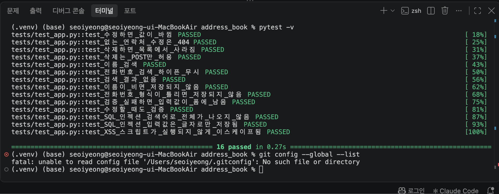
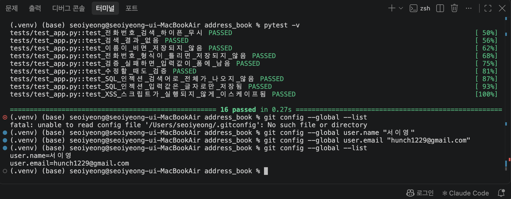
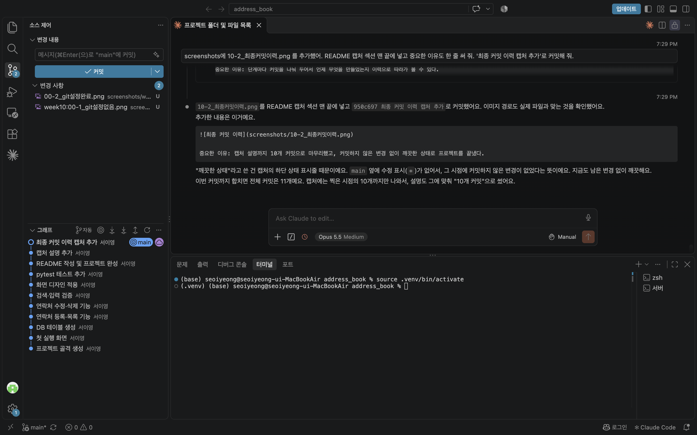
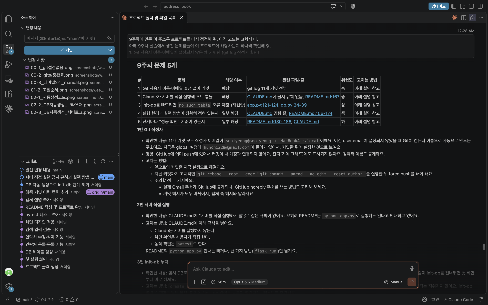
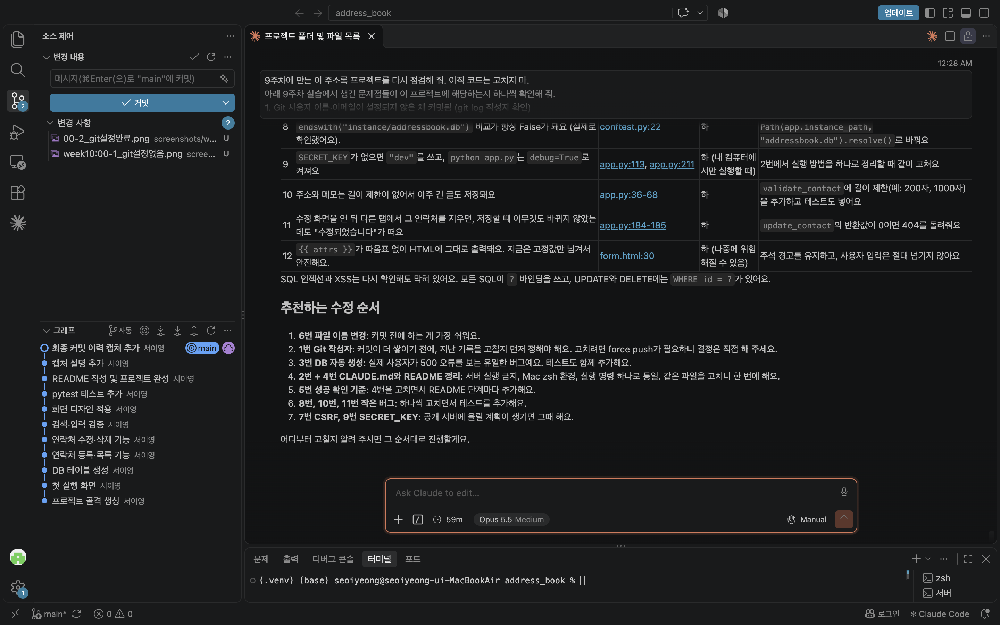
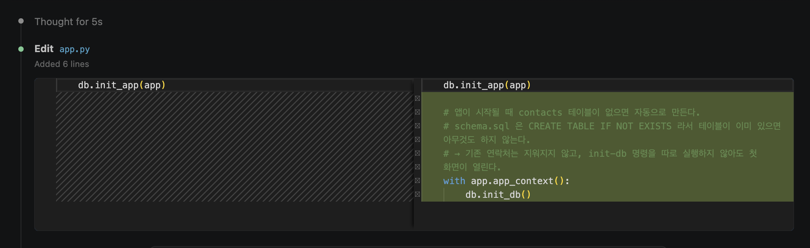
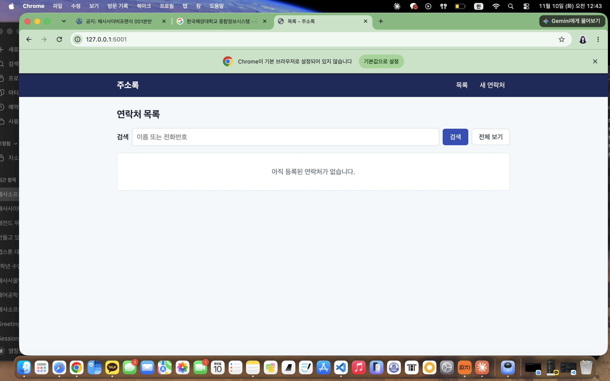
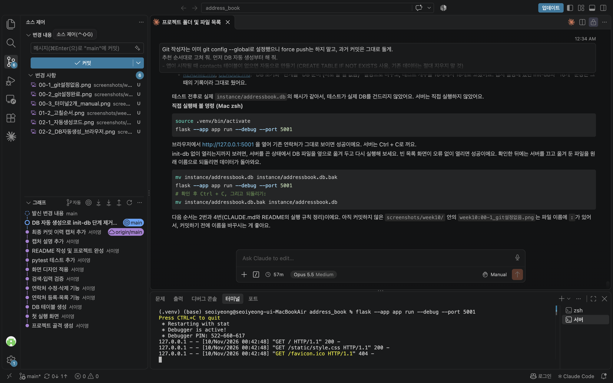
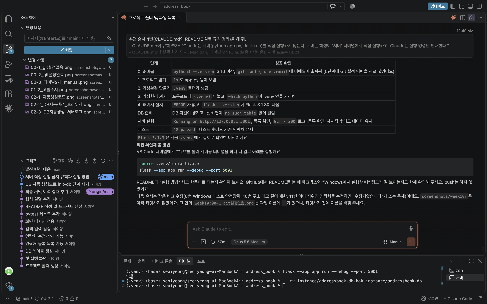

# 10주차 개선 내용

9주차에 만든 주소록 프로젝트를, 10주차 자료에 정리된 "9주차 실습에서 생긴 문제점"과 하나씩 맞춰 보고 해당하는 것을 고쳤다.

- 점검 방법: Claude Code에 "코드는 고치지 말고 점검만" 하도록 먼저 요청하고, 결과를 보고 고칠 순서를 정했다.
- 실행 환경: macOS + zsh, VS Code 터미널 2개 (Claude용 / 서버용), 서버 포트 5001
- 과거 커밋은 force push 없이 그대로 두었다.

---

## 9주차 문제점 점검과 개선 결과

| # | 9주차 문제점 | 이 프로젝트 해당 여부 | 어떻게 고쳤나 | 관련 커밋 | 성공 확인 결과 |
|---|---|---|---|---|---|
| 1 | Git 사용자 이름·이메일이 설정되지 않은 채 커밋됨 | **해당**. 9주차 커밋 11개의 작성자 이메일이 모두 `seoiyeong@seoiyeong-ui-MacBookAir.local` (Git이 컴퓨터 이름으로 자동으로 만든 주소) | `git config --global user.name`, `user.email` 설정. 과거 커밋은 force push 없이 그대로 둠 | (설정만 변경) | ✅ `git config --global --list` 에 이름·이메일이 나옴. 10주차 커밋부터 작성자가 `서이영 <hunch1229@gmail.com>` 으로 기록됨 |
| 2 | Claude가 서버(`python app.py`)를 직접 실행해서 포트 충돌이 날 수 있음 | **해당**. CLAUDE.md에 금지 규칙이 없었고, README는 오히려 `python app.py` 실행을 안내함 | CLAUDE.md에 "Claude는 서버를 직접 실행하지 않는다. 서버는 학생이 '서버' 터미널에서 실행하고, Claude는 명령만 안내한다" 규칙 추가. README에서 `python app.py` 안내 삭제 | `95b4644` | ✅ 10주차 작업 동안 Claude는 서버를 띄우지 않고 `pytest` 로만 확인함. 서버는 내가 '서버' 터미널에서 직접 켜고 끔 |
| 3 | DB 초기화 명령(init-db)을 빠뜨리면 `no such table` 오류가 남 | **해당** (위험도 상). init-db 없이 `/` 에 접속하면 `OperationalError: no such table: contacts` 로 500 오류가 나는 것을 재현함 | `create_app()` 이 시작할 때 `db.init_db()` 실행. `CREATE TABLE IF NOT EXISTS` 라서 기존 데이터는 지워지지 않음. 테스트 2개 추가 | `b74e589` | ✅ `pytest` 18 passed. DB 파일을 옮겨 두고 서버를 켜도 오류 없이 빈 목록 화면이 열림. 파일을 되돌리니 기존 연락처도 그대로 |
| 4 | 실행 환경(Mac zsh)과 서버·테스트 실행 방법이 CLAUDE.md와 README에 정확히 적혀 있지 않음 | **일부 해당**. 실행 환경이 안 적혀 있었고, 서버 실행 방법이 두 가지(`flask run`, `python app.py`)에 포트도 5000/5001이 섞여 있었음 | CLAUDE.md에 실행 환경(Mac zsh, 터미널 2개, 포트 5001) 추가. README 실행 명령을 `source .venv/bin/activate` + `flask --app app run --debug --port 5001` 하나로 통일 | `95b4644` | ✅ README 명령 그대로 실행해서 http://127.0.0.1:5001 접속 성공, 서버 로그에 `GET / 200` |
| 5 | 단계마다 "성공 확인" 기준이 없음 | **일부 해당**. init-db와 테스트에만 있었고 Git 설정·패키지 설치·서버 실행에는 없었음 | README의 모든 단계(준비물, 프로젝트 받기, 가상환경, 패키지 설치, DB 준비, 서버 실행, 테스트) 끝에 "✅ 성공 확인" 체크 항목 추가. CLAUDE.md에 "pytest 모두 통과" 완료 기준 추가 | `95b4644` | ✅ 체크 항목대로 `(.venv)` 표시, `Debugger is active!`, `18 passed` 를 직접 확인함 |

### 점검하다 같이 발견한 것

| 문제 | 처리 |
|---|---|
| 캡처 파일 이름에 `:` 가 들어감 (`week10:00-1_git설정없음.png`). Windows에서는 clone이 실패하는 이름 | ✅ 커밋 전에 `00-1_git설정없음.png` 로 이름을 바꿈 |
| init-db 명령을 테스트에서 실행하면 "Working outside of application context" 오류 | ✅ 명령에 `@with_appcontext` 를 붙여 해결 (`b74e589`) |

### 아직 안 고친 것 (다음 작업)

| 문제 | 위험도 | 계획 |
|---|---|---|
| 테스트 안전장치(`conftest.py`)가 Windows 경로(`\`)에서는 작동하지 않음 | 하 | 경로를 `Path.resolve()` 로 비교 |
| 주소·메모 길이 제한 없음 | 하 | `validate_contact` 에 길이 제한 + 테스트 추가 |
| 이미 지워진 연락처를 수정하면 "수정되었습니다" 가 뜸 | 하 | `update_contact` 반환값이 0이면 404 |
| CSRF 보호 없음, `SECRET_KEY` 기본값 `"dev"` | 중 (공개 시 상) | 공개 서버에 올릴 때 Flask-WTF, 환경변수 설정 |

---

## 10주차 실습 캡처

중요한 이유: `git config --global --list` 를 쳐 보니 설정 파일 자체가 없어서, 지금까지 커밋이 컴퓨터 이름으로 기록된 이유를 알게 됐다.

중요한 이유: 이름과 이메일을 global로 설정해서 이후 커밋부터는 내 계정으로 기록된다.

중요한 이유: Claude용 zsh 터미널과 서버용 터미널을 나눠 놓아서 서버를 누가 켰는지 헷갈리지 않는다.

중요한 이유: 코드는 고치지 않고 점검만 시켜서, 9주차 문제 5개가 이 프로젝트에 해당하는지 파일과 줄 번호로 확인했다.

중요한 이유: 문제를 위험도별로 정리하고 고칠 순서를 정한 덕분에 한 번에 하나씩 고치고 커밋할 수 있었다.

중요한 이유: `create_app()` 에 몇 줄만 추가해서 init-db를 안 해도 테이블이 생기게 했다. IF NOT EXISTS라 기존 데이터는 안전하다.

중요한 이유: DB 파일을 치워 두고 5001번으로 켰는데도 no such table 없이 빈 목록 화면이 바로 열렸다.

중요한 이유: Claude가 아니라 내가 '서버' 터미널에서 직접 서버를 켰고, 로그에 `GET / 200` 이 찍혀 오류가 없음을 확인했다.

중요한 이유: README 단계마다 성공 확인 기준이 생겨서, 다음에 처음부터 설치할 때도 어디까지 잘 됐는지 바로 알 수 있다.
